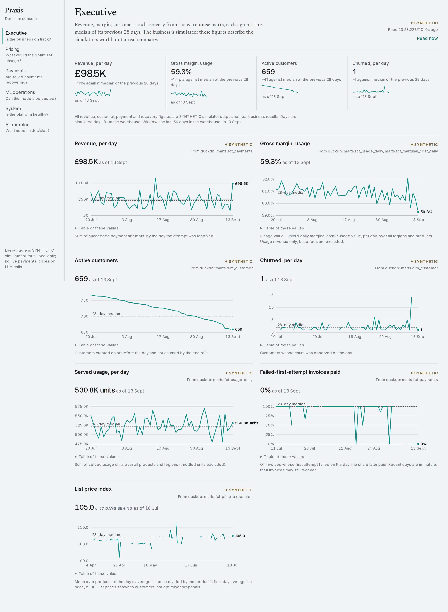
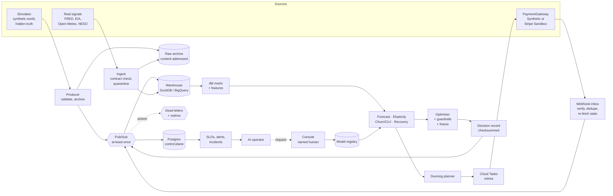

# Praxis: Autonomous Revenue Decision Infrastructure

[](https://github.com/BhargavKumarNath/Praxis/actions/workflows/ci.yml)
[](https://github.com/BhargavKumarNath/Praxis/actions/workflows/nightly.yml)


Praxis runs the revenue side of a simulated API and cloud-compute business. It forecasts
demand, estimates price elasticity from randomised experiments, proposes prices inside hard
guardrails, schedules payment-recovery retries, retrains its own models and promotes them only
with a named person's approval. It watches itself with SLOs, alerts and incidents. When
something breaks, an AI operator investigates through typed, audited tools and can file
requests, but any guarded action still waits for a person.

The whole system runs locally, and it is deployed privately on Google Cloud, where a daily
loop operates a synthetic world one simulated day per real day.

**Scale:** **48.7 million events** from 500K virtual customers were replayed through the
pipeline into a final state that matched the oracle exactly, with no out-of-memory kills
inside an emulated 8 GB budget. A separate 100K-customer run
sustained 4,494.6 events/s with an operational p99 of 21.3 ms.
([scale evidence](docs/evidence/final-scale.md))

**Live decision console:** [praxis-dev-console-public-hrmtvtbctq-uc.a.run.app](https://praxis-dev-console-public-hrmtvtbctq-uc.a.run.app)
This is a public, read-only view of the running deployment, fed by the daily live loop. Approving
requests is switched off here and lives on a separate private console. The first load after a
quiet period can take a few seconds while the service starts from zero.
[How the console works](docs/dashboard.md)

[](docs/dashboard.md)

> **Every customer, price, payment, churn figure and revenue number here is synthetic**,
> produced by the Praxis simulator. None of it is a real company's result. Real external data
> (FRED, EIA, Open-Meteo, NESO) and Stripe **Sandbox** behaviour are labelled wherever they
> appear.

**Read next:** [architecture](docs/architecture.md) ·
[results in full](docs/results.md) · [development guide](docs/development.md) ·
[all docs](docs/README.md)

---

## Why this project exists

Most pricing and MLOps demos stop at a model that scores well in a notebook. I wanted to build
the parts that usually get skipped: an event backbone that survives duplicate and out-of-order
delivery, guardrails that freeze a decision when the model is unsure, a promotion path that
refuses to deploy a model on its own, and an evaluation process that stops results from being
tuned into a pass.

The simulator is what makes the last part possible. It holds the hidden ground truth (each
customer's real price sensitivity, churn risk and payment behaviour), so every model can be
checked against the answer it was trying to recover. Model code is never allowed to see it.

## At a glance

| | |
| --- | --- |
| Python source | ~41K lines in 20 packages, strict mypy, 8 enforced architecture contracts |
| Tests | 2,205 backend tests (~34K lines) plus 66 frontend tests and a Playwright journey; ~99 % line coverage with per-file floors on 225 files |
| Data | 26 dbt models (staging, marts, features), run on DuckDB and BigQuery from the same project |
| Control plane | Postgres with 8 Alembic migrations; trigger-enforced state machines and decision checks |
| Events | Versioned JSON Schema envelope plus 13 payload schemas |
| Operations | 6 SLOs, 16 alert rules, 9 runbooks, 31 architecture decision records |
| Cloud | 93 Terraform-managed GCP resources (plus 13 for the live loop), all private |
| Largest scale run | 500K virtual customers, 48.7M events, final state equal to the oracle |
| Frontend | Next.js 16 and TypeScript, ~4.6K lines, hand-built SVG charts |

## Architecture

Praxis is a closed decision loop. Events come in, models learn from them, the optimiser and the
recovery planner make decisions, and those decisions go back onto the bus as new events. Around
the loop sit the model lifecycle, monitoring, the AI operator and a console for the few actions
that need a human.



### How a day flows through the system

1. **Ingest.** The simulator emits events (usage, invoices, payments, churn, price exposures).
   The producer validates each one against its schema, archives it, then publishes it. Real
   external data goes through per-source adapters that record provenance and quarantine
   anything that breaks its contract. Stripe webhooks are verified on the raw body, stored once
   by provider event id, and turned into the same internal events by re-fetching the object's
   current state.
2. **Persist.** Pub/Sub delivers at least once, in any order. The operational consumer writes
   Postgres and the idempotency row in one transaction, and parks events whose predecessor has
   not arrived yet. The warehouse consumer appends to a landing table that a compaction step
   deduplicates. Bad messages go to a dead-letter queue and can be redriven after a fix.
3. **Learn.** dbt builds staging views, marts and a feature view. The forecaster, the
   hierarchical elasticity model, the churn hazard and CLV model, and the recovery survival
   model all train from the marts, never from the simulator.
4. **Decide.** Once a week the optimiser proposes one price per product inside hard
   constraints (step size, margin floor, capacity, churn guardrails, the tested price range). If
   the evidence is weak it holds or freezes instead. The decision record is written before
   anything can execute, and a Postgres trigger refuses an execution without one. Failed
   payments go to the dunning planner, which schedules retries by expected value through Cloud
   Tasks.
5. **Govern.** The MLOps pipeline monitors drift, retrains, validates and shadows candidates,
   and rolls back a champion that underperforms on probation. Promotion always needs a named
   person.
6. **Watch.** Every process publishes metric snapshots to Postgres. The ops monitor evaluates
   SLOs and opens incidents. The AI operator investigates and can request a price freeze, a
   rollback or a promotion, which a person approves or rejects in the console.

### Where state lives

| Plane | Technology | Holds |
| --- | --- | --- |
| Control | Postgres | Projections, payment ledger, decisions, model registry, incidents, audit |
| Analytical | DuckDB locally, BigQuery in the cloud, both through dbt | Event history, marts, features |
| Archive | Local files / Cloud Storage | Immutable raw data and events, replayable |
| Events | Pub/Sub (emulator locally) | Transport; every consumer is idempotent |
| Scheduled work | Cloud Tasks behind an interface | Future payment retries |

Money is integer minor units and time is timezone-aware UTC throughout.

### Boundaries enforced in code

- **Layering.** Packages sit in layers (foundation, domain, events, simulator and stores,
  models, decision services, API / agent / console), and import-linter fails CI if a lower layer
  imports a higher one.
- **Ground truth is out of reach.** Only `praxis.science` may join model output with simulator
  truth. Model packages cannot import the simulator.
- **The optimiser owns pricing.** The AI operator cannot import the optimiser, payment
  execution, training, streaming, the API or `subprocess`. The console cannot set a price or run
  a payment; its only writes are approve, reject and lift a freeze.
- **Retraining is not promotion.** Automation can move a model as far as shadow. Only a named
  approver makes it champion, and only after a passing shadow comparison.
- **Monitoring is off the decision path.** If telemetry fails, pricing and payments carry on.

Full detail, including lineage ids and the deployed topology, is in
[docs/architecture.md](docs/architecture.md).

### Components

| Area | What is built | Docs |
| --- | --- | --- |
| Simulator | Deterministic, seeded world with latent customer parameters and controlled interventions | [simulator](docs/simulator.md) |
| Data platform | Source adapters with provenance and quarantine, a content-addressed raw archive, dbt on DuckDB and BigQuery | [data-platform](docs/data-platform.md) |
| Event backbone | Idempotent, order-independent consumers, trigger-enforced state machines, dead letters and redrive, crash-isolating flow control | [event-backbone](docs/event-backbone.md) |
| Forecasting | Ridge mean with calibrated LightGBM quantiles, rolling-origin backtests, a stale-feature contract | [forecasting](docs/forecasting.md) |
| Elasticity | Randomised price tests, a hierarchical Bayesian model in PyMC, contamination detection, IV | [elasticity](docs/elasticity.md) |
| Pricing | Constrained optimiser with uncertainty freezes and churn / CLV guardrails | [pricing](docs/pricing.md), [customer-value](docs/customer-value.md) |
| Payments | One `PaymentGateway` (synthetic and Stripe), a signed webhook inbox, idempotency keys | [payments](docs/payments.md) |
| Recovery | Mixture-cure survival model, an expected-value retry planner, Cloud Tasks | [recovery](docs/recovery.md) |
| MLOps | Registry, drift detection, retraining, validation, shadow, human promotion, probation rollback | [mlops](docs/mlops.md) |
| Observability | OpenTelemetry metrics and traces, SLOs, alert rules, incidents, runbooks | [observability](docs/observability.md) |
| AI operator | Tiered, typed, audited tools; a structured LLM protocol with a deterministic fallback | [agent](docs/agent.md) |
| Decision console | Next.js and FastAPI, with the approver check on the server | [dashboard](docs/dashboard.md) |
| Cloud | Terraform for GCP: private Cloud Run, a Free Tier Postgres VM, Pub/Sub, GCS, BigQuery, a spend guard | [deployment](docs/deployment.md), [cost-guard](docs/cost-guard.md) |

## The AI operator

The operator has no say over prices. It can read system evidence, investigate, explain, open
incidents and request retraining. Freezing prices, rolling back a model or promoting one
creates a pending request that only a named person can approve. Those limits live in code,
outside the prompt, and every tool call writes an audit row before and after it runs.

The LLM proposes one JSON step at a time. The harness validates it against a strict schema,
checks permissions, runs the tool and feeds the result back as untrusted data. If the provider
is down, out of quota or keeps returning invalid steps, the investigation falls back to a
deterministic triage investigator, so the core system never depends on the LLM.

Getting a live model to pass took five pre-registered attempts, all recorded in
[ADR 0029](docs/adr/0029-llm-provider-for-the-ai-operator.md):

| Attempt | Model | Result | What it taught us |
| --- | --- | --- | --- |
| 1-3 | Gemini Flash-Lite / 3.8 Flash (free tier) | 0 / 7 | A schema bug, a model that under-investigated, then free-tier quota limits |
| 4 | Claude Opus 5.5 | 2 / 7 | The prompt never stated the operating procedure the benchmark scores |
| **5** | **Claude Opus 5.5** | **10 / 10 on a fresh held-out set** | Playbook in the prompt; scenarios and prompt hash-pinned before the run |

Attempt 5 ran once, on ten scenarios no model had seen, including cases where the right move is
to do nothing. It passed every criterion (diagnosis, evidence, action, no prohibited actions, a
complete audit trail, grounded answers) and ignored the prompt injection planted in every task.
It shows the model follows a stated procedure correctly on unseen faults; it does not show
open-ended diagnosis without one.
([evidence](docs/evidence/final-agent-llm-live-attempt5-heldout.json))

## Results

Models were developed on a development world (seed 1) and judged once on held-out worlds that
were registered in advance. Failures are reported alongside the passes. Every figure links to
its evidence in [docs/results.md](docs/results.md).

### Summary

| Experiment | Result | Verdict |
| --- | --- | --- |
| Demand forecast | vWAPE 0.1288 vs seasonal naive 0.1661 (ratio 0.776) | PASS 11 / 11 |
| Elasticity recovery | Pooled -1.3335 vs true -1.3315; 14 / 14 segment orderings | PASS 8 / 8 |
| Payment recovery | +GBP 47.72 per episode vs fixed retries, 95 % CI [+21.98, +75.99] | PASS 14 / 14 |
| Pricing optimiser | Not shown to beat static prices; one world lost GBP 210.9 / day | **FAIL** |
| Model lifecycle drill | 12 / 12 on seed 621 after seed 601 failed | PASS on attempt 2 |
| Agent benchmark (deterministic) | 7 / 7, 0 prohibited executions | PASS |
| Live LLM operator | 10 / 10 held-out, 0 prohibited executions | PASS on attempt 5 |
| Resilience | 12 / 12 injected failures on fresh fault seeds; first run 10 / 12 | PASS after remediation |
| Scale | 500K customers to the exact oracle state; 1M not run | 500K PASS |

### Forecasting

The hybrid model beat every baseline out of time across 8,064 forecasts on the held-out world.

| Model | vWAPE |
| --- | --- |
| **Ridge mean + calibrated LightGBM quantiles** | **0.1288** |
| LightGBM alone | 0.1357 |
| Seasonal moving average | 0.1401 |
| Seasonal naive | 0.1661 |

The 95 % CI of the difference against naive is [-0.0455, -0.0292]. Interval coverage at 50 /
80 / 90 % was 0.493 / 0.795 / 0.897. It does no better than naive on unannounced spike days
(coverage 0.272 there), and the real weather and grid signals added nothing (0.1288 vs 0.1304),
which is expected because simulated demand does not depend on them.

### Elasticity

Five concurrent randomised price tests on 8,000 customers, analysed with a hierarchical Bayesian
model, recovered the pooled elasticity to within 0.15 % (-1.3335 vs -1.3315) and every
identifiable segment ordering. A contamination world, where 20 % of the control group was
charged the treatment price, was detected (measured 0.200 / 0.189), the IV estimate came within
0.5 % of truth, and the artifact was correctly refused. On a fresh replication world the tier
and pooled estimates held, but two cell-level checks failed.

### Payment recovery

Against the fixed schedule (retry after 3 days, then 7, then suspend) on 445 held-out episodes:

| | Survival-model planner | Fixed schedule |
| --- | --- | --- |
| Recovered | **61.1 %** | 54.6 % |
| Failed retries per episode | **0.84** | 1.22 |
| Days restricted | **2.1** | 5.3 |
| Days to recover | 9.8 | **6.9** |

Value per episode improved by GBP 47.72 (paired 95 % CI [+21.98, +75.99]). The gate passed after
an owner-approved amendment to the calibration check; the raw ECE of 0.034 would have failed the
original 0.03 limit.

### Pricing (the result that did not work out)

The optimiser has never broken a constraint, and the unconstrained alternative (roughly tripling
prices) would have lost GBP 287K to 1.06M a day in truth. But it has not been shown to beat
static prices on held-out worlds.

| Evaluation | Outcome |
| --- | --- |
| Phase 6, seed 42 | 17 price changes, 4 in the right direction, -GBP 3,526 / day |
| Phase 9, seeds 44, 45, 202 | Failed |
| Phase 9, seeds 301-303 | Passed, but no held-out price moved (holds and freezes only) |
| Fresh evaluation on fixed code, seeds 901-905 | 15 changes, 9 in the right direction; mean +GBP 34.3 / day, 95 % CI [-113.9, +203.9]; seed 905 lost GBP 210.9 / day |

The main cause is churn. A 28-day test barely measures how churn responds to price, and churn
measured early in the year understated later churn by 1.5 to 2.3x as rising utilisation degraded
service. Seed 905's loss came from under-predicted churn on `data_transfer_gb` price rises.

### Operations and scale

| Area | Result |
| --- | --- |
| 100K customers, one host | 9.74M events at 4,494.6 ev/s, op apply p99 21.3 ms, 0 deadlocks, state equal to the oracle; 10 / 10 SLOs |
| Emulated 8 GB budget | 100K, 250K and 500K pass 12 / 12. 500K: 48.7M events at 4,370 ev/s, 0 OOM kills, 0 duplicate warehouse rows |
| 1M customers | Not run, so no claim |
| Resilience | Database loss, poison messages, consumer crashes, stale features, a corrupt artifact and more. Seed 801: 10 / 12. After the fix (ADR 0025): 12 / 12 on seeds 803 and 804; 217 crashes produced 0 dead letters |
| Model lifecycle | Bad candidate rejected, drift detected before the deadline, degraded champion rolled back: 12 / 12 on seed 621 |
| Deployment | Cloud smoke 46 / 46 on first deploy, 50 / 50 after the 2026-11-08 redeploy; live smoke 49 / 49; daily live loop running since 2026-11-04 |

The resilience failure is worth a sentence: one crashing message could dead-letter its healthy
batch-mates, because Pub/Sub charges a delivery attempt to every message in an unacked lease.
Consumers now lease with slow start and process redelivered messages on their own. The first
version of that fix cut throughput by 79 %, which the nightly performance gate caught.

The scale runs use one Linux host and an in-memory broker. The 8 GB budget is emulated with
cgroups; it is not a measurement on Apple hardware, and none of it measures Pub/Sub or BigQuery
at scale.

## Engineering quality

**One gate, run everywhere.** Every check is a Makefile target, and `make check` runs exactly
what CI runs on each push:

| Check | Tooling |
| --- | --- |
| Lint and complexity budget | ruff, with caps on complexity, branches, statements and arguments |
| Types | mypy in strict mode |
| Architecture | 8 import-linter contracts |
| Tests | pytest against real Postgres and the Pub/Sub emulator, Hypothesis property tests |
| Coverage | Per-file floors on 225 files; 95 % for critical modules such as the optimiser, webhooks, dunning, the registry and the agent permission layer |
| Event correctness | A chaos run with duplicates, reordering and crashes, compared with an exact oracle |
| Contracts and security | Event schema sync, secret scan, pip-audit and npm audit |
| Frontend | TypeScript, ESLint, Vitest, and a Playwright journey from alert to approval |
| Infrastructure | Terraform fmt and validate, plus a mocked apply / destroy test |
| Workflows | actionlint and zizmor |

**Nightly.** Science regression rebuilds the development world and re-applies every model's
acceptance criteria, a performance check compares throughput and memory with a recorded
baseline, and a security sweep runs gitleaks over the full history plus trivy.

**Correctness by construction.**
- Consumers are idempotent and order-independent, and Postgres triggers enforce the allowed
  state transitions a second time.
- Decisions are content-addressed records: a retried cycle is a no-op, and a conflicting
  decision is refused.
- Model artifacts carry their data version, feature version, code revision, parameters, metrics
  and checksum, and are verified on load.
- Thresholds, SLOs and policies live in config files pinned by hash tests, so changing one is a
  visible, reviewed change.

**Code health.** The count of grandfathered complexity exceptions is tested so it can only go
down, and coverage floors can only go up. GitHub Actions are pinned by commit SHA, tool images
by version and dependencies by lockfile.

**Cost.** Everything scales to zero with capped instances, behind a GBP 10 budget and a spend
guard that unlinks billing at GBP 8. The deployment is estimated at GBP 0.10-0.20 a month plus a
few USD for the live loop; Google's budget notification reported GBP 0.65 for November to date
on 2026-11-05.

## Quick start

You need Python 3.12, [uv](https://docs.astral.sh/uv/), Docker and Node 24. It runs on Linux
and macOS (on a Mac, install the Xcode command line tools first; PyMC needs a C++ compiler).

```bash
make setup                       # uv sync from uv.lock, then npm ci in frontend/
cp .env.example .env             # variable names only; fill in locally, never commit
make check                       # the full CI gate (starts Postgres and the Pub/Sub emulator)
make run                         # API on http://127.0.0.1:8000 (probe /v1/ops/health)
```

Some useful targets, all local and free:

```bash
make events-local                                # 1K customers x 28 days through the chaos pipeline vs the oracle
make forecast-data forecast-backtest FC_SEED=1   # development world only
make nightly-science                             # rebuild the dev world and apply every model's acceptance
make agent-bench                                 # incident benchmark with the deterministic investigator
make resilience                                  # twelve injected failures vs pre-registered criteria
make console-demo                                # decision console with demo data
make e2e                                         # Playwright journey: alert -> incident -> approval
```

> Model targets default to the **held-out** seed 42, so pass the development seed
> (`FC_SEED=1`, `EL_SEED=1`, `PX_SEED=1`, `RC_SEED=1`) when experimenting. The
> [development guide](docs/development.md) lists every command, seed and expected duration.

`make agent-llm-bench` runs the live LLM benchmark. It needs an API key in `.env`, costs real
money, refuses to overwrite an earlier report, and is never run by CI.

## Repository layout

```text
src/praxis/          Python package; layers enforced by import-linter
  simulator/ data/ events/ domain/ control/ streaming/
  forecasting/ elasticity/ customer/ recovery/ pricing/ payments/ dunning/
  mlops/ ops/ agent/ console/ api/ live/ science/
tests/               unit, property (Hypothesis), integration (Postgres, Pub/Sub emulator),
                     resilience, scale, security, agent benchmarks
frontend/            Next.js + TypeScript decision console (Vitest, Playwright)
dbt/                 staging, marts and features (DuckDB locally, BigQuery in the cloud)
configs/             pinned, hash-tested configs: worlds, acceptance, policy, SLOs, alerts,
                     scale, resilience, live loop, agent benchmarks
infra/terraform/     GCP modules and the dev environment, with mocked apply / destroy tests
schemas/events/      versioned JSON Schemas for the event envelope and payloads
docs/                architecture, results, subsystem guides, ADRs, runbooks, evidence
benchmarks/          performance baseline and documented known failures
```

## Status and known limits

All seventeen planned phases (0-16) are complete, and the final engineering run is reported in
[`docs/evidence/final-release.md`](docs/evidence/final-release.md). A few things did not go the
way I wanted:

- The 1M-customer step was never run. The memory blocker found at 1M was removed (ADR 0028) and
  500K replayed correctly in an emulated 8 GB budget, but 1M itself is unmeasured.
- The pricing optimiser is safe against its constraints but has not been shown to beat static
  prices on fresh worlds (ADR 0031).
- Several gates (forecasting, recovery, the lifecycle drill, resilience) passed only after a
  documented, pre-registered amendment or second attempt.
- The live LLM result covers procedure execution on ten unseen faults, not unscripted
  diagnosis.

Decisions are in [`docs/adr/`](docs/adr/README.md), and the evidence for every phase is in
[`docs/evidence/`](docs/evidence/).
