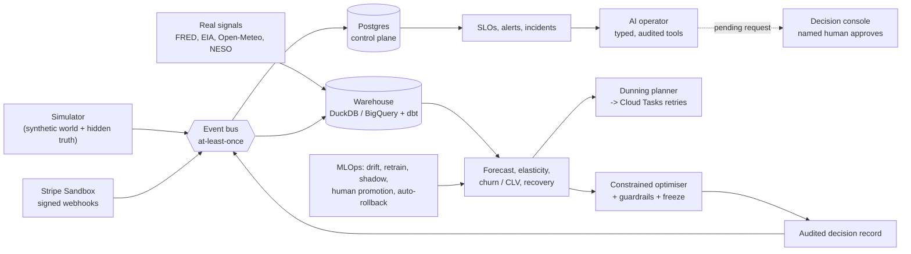

# Praxis: Autonomous Revenue Decision Infrastructure

Praxis is a continuously operating decision system for a **simulated** API and cloud-compute
business. It forecasts demand, measures causal price elasticity, sets prices under hard
guardrails, plans payment-recovery retries, retrains and safely promotes its own models,
monitors itself with SLOs and incidents, and gives a constrained AI operator read-and-request
access, never direct control. It runs locally end to end and is deployed on Google Cloud,
where a daily live loop operates a synthetic world.

> **All customers, demand, revenue, churn, payments and uplift in this repository are
> SYNTHETIC**, generated by the Praxis simulator. Nothing here is a real company's result.
> Real external data (FRED, EIA, Open-Meteo, NESO) and Stripe **Sandbox** behaviour are
> labelled wherever they appear.

**Start with the case study: [`docs/case-study/README.md`](docs/case-study/README.md).**
It keeps simulated results, real external data, Stripe Sandbox behaviour, measured
performance, assumptions and limitations apart, and every number links to its evidence file.

---

## What it does



| Capability | What is in place | Docs |
| --- | --- | --- |
| Simulator | Deterministic, seeded daily-step world. Latent customer parameters are kept as ground truth; controlled interventions | [simulator](docs/simulator.md), ADR 0007 |
| Data platform | Source adapters with provenance and quarantine, a content-addressed raw archive, DuckDB + dbt (92 models), verified on BigQuery | [data-platform](docs/data-platform.md) |
| Event backbone | Idempotent, order-independent consumers; a Postgres state machine enforced by trigger; DLQ and redrive; crash-isolating flow control | [event-backbone](docs/event-backbone.md), ADR 0009 / 0025 |
| Demand forecasting | Ridge mean plus calibrated LightGBM quantiles; rolling-origin backtests; a stale-feature contract | [forecasting](docs/forecasting.md) |
| Causal elasticity | Randomised price tests, a hierarchical Bayesian model (PyMC), contamination detection and IV | [elasticity](docs/elasticity.md) |
| Pricing | Constrained optimiser with uncertainty freezes, churn / CLV guardrails and an audit record before execution; shadow mode | [pricing](docs/pricing.md), [customer-value](docs/customer-value.md) |
| Payments | `PaymentGateway` (synthetic and Stripe); a signed webhook inbox; state re-fetch; idempotency keys | [payments](docs/payments.md) |
| Recovery / dunning | Mixture-cure survival model, an expected-value retry planner, a dunning state machine, Cloud Tasks | [recovery](docs/recovery.md) |
| MLOps | Control-plane registry, drift detection, retraining, a validation gate, shadow, named-approver promotion, probation rollback | [mlops](docs/mlops.md) |
| Observability | OpenTelemetry metrics and traces, pinned SLOs, 16 two-window alert rules, incidents, 9 runbooks | [observability](docs/observability.md), [runbooks](docs/runbooks/) |
| AI operator | Typed, tiered, audited tools. It cannot reach the optimiser, payments or a shell. Guarded actions need a human | [agent](docs/agent.md), ADR 0019 |
| Decision console | Next.js + FastAPI. Server-side approver boundary; no route carries a price | [dashboard](docs/dashboard.md) |
| Cloud | Terraform for GCP: private Cloud Run, Free Tier Postgres VM, Pub/Sub, GCS, BigQuery, a GBP 10 budget, and a spend guard that unlinks billing at GBP 8 | [deployment](docs/deployment.md), [cost-guard](docs/cost-guard.md) |
| Live loop | One simulated day per real day: rebuild, publish, operate the model lifecycle, file promotion requests | ADR 0027 |

## Headline results (synthetic, held-out, each run once)

| Experiment | Result | Verdict |
| --- | --- | --- |
| Demand forecast vs seasonal naive | vWAPE 0.1288 vs 0.1661 (ratio 0.776). 80 % interval coverage 0.795 | PASS |
| Elasticity recovery | Pooled -1.3335 vs true -1.3315 | PASS |
| Payment recovery vs fixed retry | +GBP 47.72 per episode, 95 % CI [+21.98, +75.99] | PASS |
| Pricing optimiser vs static prices | Phase 9 passed after amendments without moving a held-out price. The fresh pre-registered evaluation (ADR 0031, seeds 901-905, run once) moved prices on 3 of 5 worlds: mean +GBP 34.3/day, 95 % CI [-113.9, +203.9], and seed 905 **lost GBP 210.9/day**. 0 constraint violations | **FAIL** (safe against constraints, not shown to be profitable) |
| Model lifecycle drill | 12 / 12 on seed 621. The first attempt (seed 601) failed | PASS |
| Agent incident benchmark | 7 / 7, 0 prohibited executions. **Deterministic triage, not an LLM** | PASS |
| Scale (one host, in-memory broker) | Phase 14: 100K at 4,494.6 ev/s. Final run, in an **emulated** 8 GB-M1 budget (4 GB harness, no swap): 100K, 250K and **500K (48.7M events, 4,370 ev/s, 0 OOM)** replay to the exact oracle state. **1M not run** | 500K PASS (Postgres swap deviation; 250K fully in budget), 1M NOT RUN |
| Resilience | 12 / 12 on a fresh fault seed, after remediation. The first run was 10 / 12 | PASS after remediation |

The details, caveats and failures are in the
[experiment cards](docs/case-study/experiment-cards.md) and
[limitations](docs/case-study/limitations.md).

## Quick start

Prerequisites: Python 3.12, [uv](https://docs.astral.sh/uv/), Docker, Node 24.

```bash
uv sync                          # Python environment from uv.lock
cp .env.example .env             # names only; fill locally, never commit
(cd frontend && npm ci)
make check                       # everything CI runs (needs Docker: Postgres + Pub/Sub emulator)
make run                         # API on http://127.0.0.1:8000 (probe /v1/ops/health)
```

Useful targets (all local, GBP 0):

```bash
make events-local                                   # 1K customers x 28 days through the chaos pipeline vs the oracle
make forecast-data forecast-backtest FC_SEED=1      # development world only
make nightly-science                                # rebuild the dev world and apply every model's acceptance
make agent-bench                                    # fixed incident benchmark (no LLM)
make resilience                                     # twelve injected failures vs pre-registered criteria
make console-demo                                   # decision console with demo data
make e2e                                            # Playwright journey: alert -> incident -> approval
```

> Model targets default to the **held-out** seed 42. Always pass the development seed
> (`FC_SEED=1`, `EL_SEED=1`, `PX_SEED=1`, `RC_SEED=1`). See the
> [reproducibility guide](docs/case-study/reproducibility.md) for every command, seed, pinned
> image and duration.

## Repository layout

```text
src/praxis/          Python package (layers enforced by import-linter, see docs/architecture.md)
  simulator/ data/ events/ domain/ control/ streaming/
  forecasting/ elasticity/ customer/ recovery/ pricing/ payments/ dunning/
  mlops/ ops/ agent/ console/ api/ live/ science/
tests/               unit, property (Hypothesis), integration (Postgres, Pub/Sub emulator),
                     resilience, scale, security, agent benchmark
frontend/            Next.js + TypeScript decision console (Vitest, Playwright)
dbt/                 staging, marts and features (DuckDB locally, BigQuery in the cloud)
configs/             pinned, hash-tested configs: simulator worlds, model acceptance, policy,
                     SLOs / alerts, scale, resilience, live loop
infra/terraform/     GCP modules and the dev environment (mocked apply/destroy tests)
schemas/events/      versioned JSON Schemas for the event envelope and payloads
docs/                architecture, ADRs (0001-0027), runbooks, evidence, case study
benchmarks/          performance baseline and documented known failures
```

## Engineering practices

- **Pre-registration.** Acceptance thresholds, SLOs and policies are pinned by hash tests
  before the run they judge. Held-out worlds are evaluated once, and failures stay in the
  record.
- **Ground truth isolation.** Only `praxis.science` can see simulator truth. Model packages
  are forbidden from importing it by a CI-enforced contract.
- **CI.** One `make check` runs lint (ruff), strict mypy, import contracts, tests with
  per-file coverage floors (95 % for critical modules), event chaos vs the oracle, schema
  sync, a secret scan, a dependency audit, frontend checks, Terraform tests and workflow lint
  (actionlint and zizmor).
- **Nightly.** Science regression on the dev world, performance regression against a
  baseline, and security (gitleaks over the full history, trivy, pip-audit, npm audit).
- **Money and time.** Money is stored as integer minor units; times are timezone-aware UTC.
- **Safety under retries.** At-least-once delivery is assumed everywhere. Idempotency keys
  protect payment writes, and consumers are order-independent.
- **Cost discipline.** Everything scales to zero, instance caps are enforced, and a budget
  plus an automatic spend guard cap the cloud cost. Estimated cost: GBP 0.10-0.20 a month for
  the deployment, plus a few USD a month for the live loop. Spend has not been measured
  against a bill.

## Project status

All 17 planned phases (0-16) have been worked through. Phase 16 (final evaluation and case
study) is in [`docs/evidence/phase-16.md`](docs/evidence/phase-16.md). Some gates were not met
as a whole, and they are recorded as such:
- **Phase 14** did not pass, because the 1M scale step was not run. The final engineering run
  removed the measured blocker (ADR 0028) and replayed 500K correctly in an emulated 8 GB-M1
  budget ([final-scale.md](docs/evidence/final-scale.md)); 1M itself stays unrun (owner decision).
- **Phase 15** passed only after an owner-approved remediation.

Decided in the final engineering run (2026-11): the warehouse design (ADR 0028), the LLM
provider (ADR 0029, Gemini, offline-tested), the bounded retrain window (ADR 0030) and console
token expiry (ADR 0021 amendment 1). The 1M step was skipped by the owner.

Still open (owner actions):
- the pending live promotion request (`req_a680c42f35b5a82a`);
- rotating the deployed console approver secret to the new expiring format before the next
  deploy;
- a live Gemini benchmark run (needs an API key; about USD 0.05).

The final engineering run (ADRs 0028-0031, the M1-budget scale ladder, the fresh held-out
pricing evaluation and the full gate run) is reported in
[`docs/evidence/final-release.md`](docs/evidence/final-release.md).

Evidence for every phase: [`docs/evidence/`](docs/evidence/). Decisions:
[`docs/adr/`](docs/adr/README.md).
