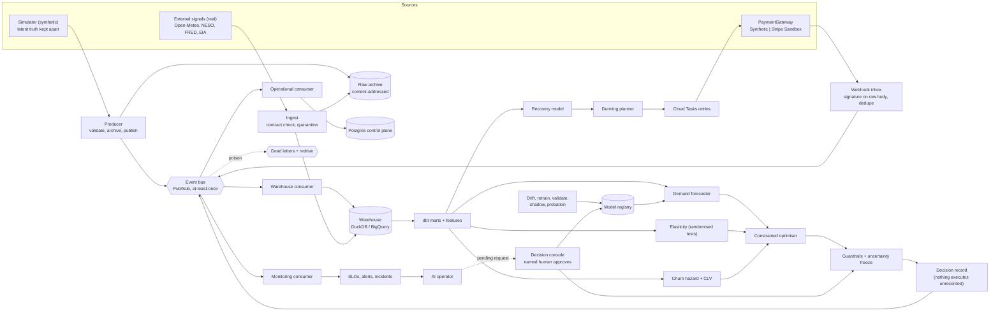
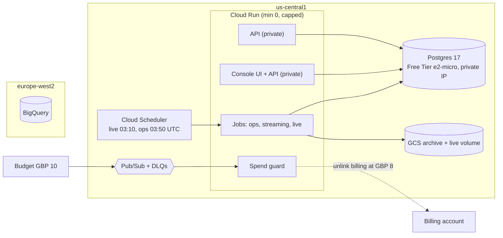

# Architecture

Praxis is a closed decision loop. A simulator produces a synthetic business; events flow into
an operational store and a warehouse; models trained on the warehouse feed a constrained
optimiser and a payment-recovery planner; their decisions go back onto the event bus as new
events. Around that loop sit the MLOps lifecycle, the monitoring stack, an AI operator and a
console where a person approves the few actions that need one.

Everything decision-related is synthetic. Ground truth from the simulator never enters the
loop: only `praxis.science` can join model output with truth, and an import contract stops
model packages from reaching it.

## The loop



## Where state lives

| Plane | Technology | Holds |
| --- | --- | --- |
| Control | Postgres | Mutable operational state: projections, ledger, decisions, registry, incidents, audit |
| Analytical | DuckDB locally, BigQuery in the cloud, both through dbt | Event history, marts, features |
| Raw archive | Local files / Cloud Storage | Immutable source data and events, content-addressed and replayable |
| Events | Pub/Sub (emulator locally) | Transport. Delivery is at-least-once, so every consumer is idempotent |
| Scheduled work | Cloud Tasks, behind a `TaskQueue` interface | Future payment retries |

Money is stored as integer minor units, never floats. Times are timezone-aware UTC.

## Layers

The package layout is enforced by import-linter (`make arch`). Higher layers may import lower
ones, never the reverse, and `|` siblings are independent of each other.

```text
console
api | science | agent
dunning
pricing | payments | mlops
streaming | forecasting | elasticity | recovery | customer | ops
control | data | simulator
events
domain
foundation: config, logging, tracing, provenance, errors, observability, glm, telemetry
```

Eight contracts are checked in CI. The ones that carry the design:

- Model and decision packages never import the simulator.
- The AI operator cannot reach the optimiser, payment execution, MLOps training, streaming,
  the API or `subprocess`. Nothing in the core imports the agent.
- The console cannot set prices, execute payments or reach ground truth.

A violation is fixed by moving the shared piece down a layer, not by adding an ignore.

## Boundaries that matter

- **The optimiser owns pricing** (ADR 0004). The LLM never sets a price. A Postgres trigger
  refuses any price execution without a matching, checksummed decision record, in shadow
  mode, or without approval in recommend mode.
- **All payment operations go through `PaymentGateway`** (ADR 0003). Stripe webhooks are
  verified and stored, then the object's current state is re-fetched and turned into the same
  internal events the synthetic gateway produces (ADR 0014).
- **Retraining never implies promotion** (ADR 0005, 0017). The registry decides which model
  serves. Promotion needs a named approver and a passing shadow comparison. The only
  automatic champion change is a probation rollback to the previous version.
- **Consumers are idempotent and order-independent** (ADR 0009). State changes only through
  allowed transitions, enforced again by Postgres. Crash handling isolates bad messages so
  healthy ones are not dead-lettered with them (ADR 0025).
- **Monitoring is off the decision path** (ADR 0018, 0020). If telemetry fails, pricing,
  payments and MLOps carry on.
- **Guarded actions need a person.** The AI operator and the live loop can only file
  requests. The console's only writes are approve, reject and lift a freeze, each authorised
  server-side by a token that names the approver (ADR 0019, 0021).

## Versions and lineage

Every artifact and decision carries content-derived versions, so the same inputs give the
same ids on any machine and any number can be traced back to its data.

| Identifier | Derived from |
| --- | --- |
| `world_config_hash` | The simulator scenario TOML |
| `data_version` (`panel-*`, `units-*`, ...) | Exact integer and DECIMAL aggregates of the marts |
| `model_version` (`demand-hybrid-*`, ...) | Checksum over the artifact files, lineage included |
| `policy_version` | Hash of the pinned pricing policy |
| `decision_id` (`dec-*`) | Hash of cycle, product, date, mode, policy version and input lineage |

Artifacts are checksum-verified on load, so a tampered file is refused. Pricing refuses a
forecast artifact that was not trained on a prefix of the world it is deciding on.

## Logs and trace ids

- Logs are one JSON object per line, with `timestamp`, `level`, `logger`, `message`,
  `service`, `trace_id` and `correlation_id`, plus domain fields such as `event_id`,
  `model_version`, `policy_version` and `decision_id`.
- `trace_id` is W3C / OpenTelemetry compatible. `correlation_id` is one UUID per business
  flow. Both are mandatory on every event envelope, and consumers re-bind them before
  processing. `causation_id` links an event to its direct cause.
- HTTP responses echo `X-Correlation-ID`. Error responses include it and never a stack trace.
- Keys that look like secrets are redacted as a backstop, but secrets are never passed to a
  logger in the first place. Important behaviour is also a metric or an audit row, never only
  a log line.

## Deployed topology

The dev environment runs in `praxis-dev-510522`: compute in us-central1, BigQuery in
europe-west2. Details and the runbook are in [deployment.md](deployment.md).



Cloud Run reaches the database over Direct VPC egress. There is no external IP, NAT or load
balancer. Every service is private, except an optional read-only copy of the console that
anyone may view (ADR 0032); it holds no approver secret. Each process has its own service account with resource-level grants only, and
secrets live in Secret Manager, never in Terraform state.
