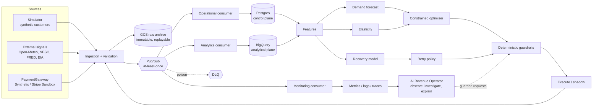

# Praxis Architecture (Phase 0 contract)

Praxis is a closed-loop decision system for a **simulated** API / compute business. All
customers, revenue and outcomes are synthetic unless a view explicitly says otherwise.

## System diagram



The loop is only complete when outcomes flow back into ingestion (right to left above).

## Planes

| Plane | Technology | Holds |
| --- | --- | --- |
| Control | Postgres (deployed: Postgres 17 on a Free Tier e2-micro VM, private IP only; ADR 0026) | Mutable operational state, decisions, dedupe keys, audit |
| Analytical | BigQuery | Large facts and marts, partitioned by event date |
| Raw archive | Cloud Storage | Immutable / append-only raw and replay data |
| Events | Pub/Sub | Transport; assume at-least-once |
| Scheduled retries | Cloud Tasks (behind an abstraction) | Future payment retry execution |

## Repository layout

```text
src/praxis/        Python package: api, config, logging, tracing, events (envelope, payloads, codec),
                   domain (state machines, projections), simulator (Phase 1), data (Phase 2),
                   streaming (Phase 3 transport, producer, consumers), control (Postgres + Alembic),
                   forecasting (Phase 4), elasticity (Phase 5), pricing (Phase 6 optimiser, audit
                   store), payments (Phase 7 PaymentGateway: Stripe Sandbox + synthetic, webhook
                   inbox, processor), recovery + dunning (Phase 8), customer + glm (Phase 9),
                   mlops (Phase 10 registry, validation gate, drift, shadow, probation, serving
                   router), ops (Phase 11 SLOs, alerts, incidents), agent (Phase 12 AI operator:
                   typed tools, permission layer, audit, guarded requests), console (Phase 13
                   decision console API: panel read model, approver boundary), science (the
                   only package joining model output with ground truth)
tests/             unit, contract, simulator, data, streaming, control, integration (emulator),
                   payments (contract suite on both gateways; live Stripe only via stripe-verify)
schemas/events/    Versioned JSON Schemas: envelope and per-event payloads (payloads/)
configs/simulator/ Stable simulator world definition (TOML)
frontend/          Next.js + TypeScript decision console (Phase 13; docs/dashboard.md)
infra/terraform/   modules/ (storage, pubsub, bigquery) and envs/dev
docs/              architecture, glossary, conventions, cost guard, ADRs, phase evidence
scripts/           Repository tooling (secret scan, schema export, bounded readiness wait)
```

## Boundaries that must not erode

* The optimiser owns pricing; the LLM never does (ADR 0004). No price executes without a
  persisted decision record; Postgres enforces it by trigger (ADR 0013, `docs/pricing.md`).
* All payment operations go through `PaymentGateway` (ADR 0003). Stripe webhooks are only
  verified and stored in the request; state is re-fetched asynchronously and turned into the
  same internal events the synthetic provider produces (ADR 0014, `docs/payments.md`).
* Retraining never implies promotion (ADR 0005). The control-plane registry, not an
  environment variable or an MLflow alias, decides which model version serves; promotion
  needs a named approver and a passing shadow; the only automatic champion change is a
  probation rollback that restores the previous version (ADR 0017, `docs/mlops.md`).
* Operations (ADR 0018, `docs/observability.md`): OpenTelemetry metrics and traces share the
  Praxis trace id; SLOs and alert rules are pinned config evaluated by pure functions; firing
  alerts become deduplicated incidents that link a runbook. Each process publishes its metrics
  to the control plane and the ops monitor / health API read the merged, staleness-checked
  fleet view (ADR 0020). None of it is on the decision path: if telemetry or ops fail,
  pricing, payments and MLOps are unaffected (a failed publish is logged and skipped).
* Scale (ADR 0022, `docs/evidence/phase-14.md`): consumers scale out as independent shard
  processes over one Postgres (no shared in-process state, no ordering assumption), batch
  sinks micro-batch with a bounded window, and large event history lives in the archive and
  the warehouse, never Postgres. Scale claims exist only where a run measured them.
* The AI operator (ADR 0019, `docs/agent.md`) sits at the top layer and nothing imports it.
  It reaches the system only through typed, tiered, audited tools; it cannot import the
  optimiser, the pricing cycle, payment execution or a shell (import contract). Guarded
  actions (freeze, rollback, promotion) are pending requests that a named human completes
  through the existing approval paths; a price freeze blocks execution in the store and by a
  Postgres trigger.
* The decision console (ADR 0021, `docs/dashboard.md`) is the top layer, a separate process.
  It reads; its only writes are approve / reject a guarded request and lift a freeze, through
  `ApprovalDesk`, `ModelRegistry` and `FreezeStore`, authorized server-side by a token that
  names the approver. It cannot import the optimiser, the pricing service, payment execution,
  streaming, the simulator or science (import contract), and no route can carry a price.
* Resilience (ADR 0023, `docs/evidence/phase-15-remediation.md`): twelve failures are
  injected against real boundaries by `tests/resilience/` and judged against pre-registered
  criteria (active: `configs/resilience/remediation-804.toml`); alerts use the two-window rule (cumulative AND
  since-last-tick), so an incident opens on the first tick and clears after recovery.
* Consumer flow control (ADR 0025): each consumer process leases through `FlowControl`
  (slow start; first deliveries, then first redeliveries, as separate groups; a message
  redelivered twice is leased and processed alone), so a crash costs delivery attempts only
  where the evidence points, and healthy messages stay out of the DLQ. The resulting small
  warehouse writes use a primary-key lookup + plain INSERT (ADR 0025 amendment 1).
* Cloud posture (ADR 0024, `infra/terraform`): one service account per process with only
  resource-level grants, secrets readable by named processes only (values never in state),
  only the API public, the console private, Cloud Run scale-to-zero with capped instances,
  a GBP budget alert and an enforced BigQuery daily quota. `make tf-test` proves the dev
  environment applies and destroys cleanly against mocked providers (no spend).
* Deployment (ADR 0026, `docs/deployment.md`): `praxis-dev-510522`, with compute in
  us-central1 and BigQuery in europe-west2. Everything is private, including the API until
  Stripe is switched on. Cloud Run reaches the database VM over Direct VPC egress; there is
  no external IP, NAT or load balancer. Consumers and the ops monitor run as on-demand
  Cloud Run jobs. A GBP 10 budget feeds a spend guard that unlinks billing at GBP 8; this
  is the single classified project-level grant.
* Large-scale tests use the synthetic gateway only (ADR 0006).
* Consumers are idempotent and order-independent; state changes only via transition tables,
  enforced again in Postgres (ADR 0009, `docs/event-backbone.md`).
