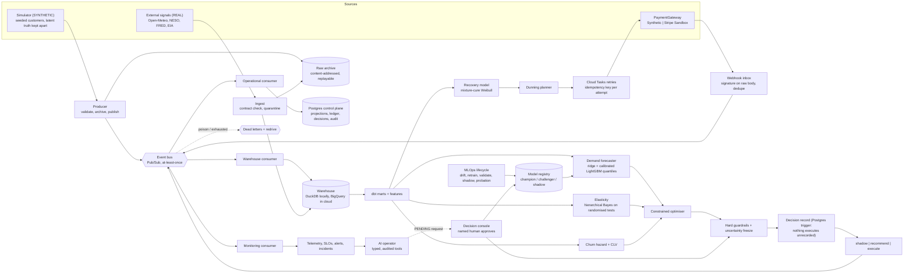
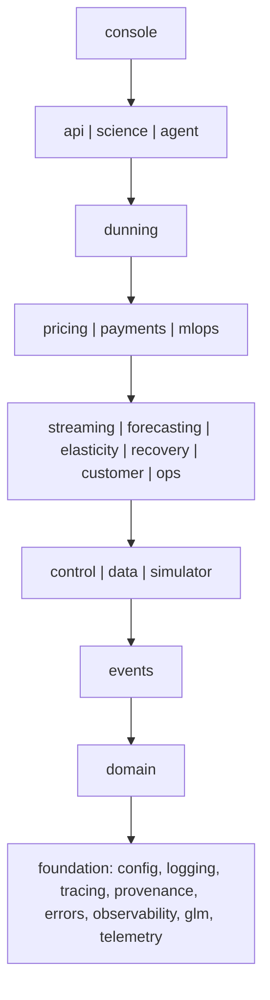
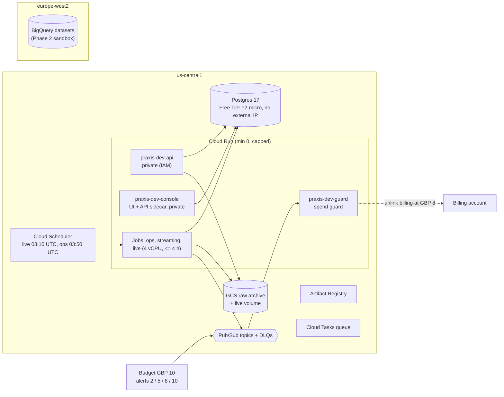

# Architecture

Praxis is a closed-loop decision system for a **simulated** API and cloud-compute business. Every
customer, invoice and amount below is synthetic unless the diagram labels it otherwise. The
binding contract is [`docs/architecture.md`](../architecture.md). The decisions behind it are the
ADRs in [`docs/adr/`](../adr/README.md).

## 1. Logical architecture (the decision loop)

The loop closes when executed decisions and payment outcomes return to the bus as events.
Ground truth from the simulator never enters this loop. Only `praxis.science` joins model
output with truth, and an import contract stops model packages from reaching it (ADR 0012).

## 2. Layers (enforced by `make arch`, import-linter)

Additional contracts:
- Models never import the simulator.
- The AI operator cannot reach the optimiser, payment execution, MLOps training, streaming,
  the API or `subprocess`.
- The console cannot set prices, execute payments or reach ground truth.
- Nothing in the core imports `praxis.agent`.

## 3. Deployed topology (`praxis-dev-510522`, ADR 0026 / 0027)

- Cloud Run reaches the VM over Direct VPC egress. There is no NAT, load balancer or public
  address.
- One service account per process, with resource-level grants only. The one project-level
  grant is the spend guard's `roles/billing.projectManager`.
- Secrets live in Secret Manager. Values never appear in Terraform or its state.

Evidence: [`deployment.md`](../evidence/deployment.md), the
[smoke report](../evidence/deployment-smoke.json) (46 / 46),
[`live-loop.md`](../evidence/live-loop.md) and the
[live smoke](../evidence/live-deployment-smoke.json) (49 / 49).
