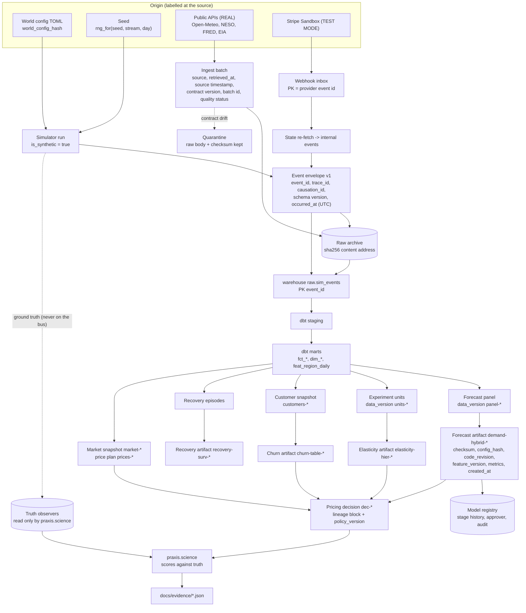

# Data lineage

Every artifact and decision in Praxis carries content-derived versions. Any number can
therefore be traced back to the raw data and the configuration that produced it. Versions are
hashes, not counters, so the same inputs give the same version on any host.

## 1. Lineage graph

## 2. What each version is derived from

| Identifier | Derived from | Example (real id from an evidence file) |
| --- | --- | --- |
| `world_config_hash` | the scenario TOML | `02be88f7...` (Phase 9 seed 301) |
| `data_version` (panel) | exact integer and DECIMAL aggregates of the marts | `panel-8b9cab7bf9c927c0` (Phase 4 held-out) |
| `data_version` (units) | experiment units table | `units-efcc3bdae7231916` (Phase 5 held-out) |
| `model_version` | checksum over the artifact files, which include the lineage | `demand-hybrid-f4ab82a52a1c`, `elasticity-hier-7aeb4dc45d43` |
| `policy_version` | hash of the pinned `configs/pricing/policy.toml` | `policy-ac62f347cbda` (Phase 6) |
| `decision_id` | hash of cycle, product, date, mode, policy version and the input lineage block | `dec-b42775bc5fdc72f57e1b` |
| `market_snapshot` | exact snapshot of prices, costs and utilisation | `market-ea7a903a0ebfb5bf` |

Sources: [`phase-4-artifact-manifest.json`](../evidence/phase-4-artifact-manifest.json),
[`phase-5-artifact-manifest.json`](../evidence/phase-5-artifact-manifest.json),
[`phase-6-eval-seed42-shadow.json`](../evidence/phase-6-eval-seed42-shadow.json) and
[`phase-9-heldout-seed301-shadow.json`](../evidence/phase-9-heldout-seed301-shadow.json).
[`decision-trace.md`](decision-trace.md) follows one id through this graph.

## 3. Guarantees that keep lineage honest

- **Determinism.** Two independent builds of the same world give the same `data_version`.
  Phase 4 fixed a float-ordering defect here; the regression test has a negative control
  ([phase-4.md](../evidence/phase-4.md), "Known limitations").
- **Lineage guards.** Pricing refuses a forecast artifact whose `data_version` is not a prefix
  of the world it decides on. On Phase 6 dev this refused a stale artifact
  ([phase-6.md](../evidence/phase-6.md)).
- **Checksums on load.** A tampered artifact is rejected (`artifact_integrity`; resilience row
  9, [phase-15-remediation-failures.json](../evidence/phase-15-remediation-failures.json)).
- **Synthetic labelling.** Every evidence JSON and every artifact carries
  `is_synthetic: true`. Real external batches carry their source and retrieval time
  ([phase-2.md](../evidence/phase-2.md)).
- **Disclosed defect.** Before Phase 10, a loaded demand artifact applied its categorical
  coefficients in the wrong column order. This affects the Phase 6 and Phase 9 shadow results.
  It was fixed in Phase 10, and those results stand as measured with the defect
  ([phase-6.md](../evidence/phase-6.md), "Disclosure added 2026-10-25").
