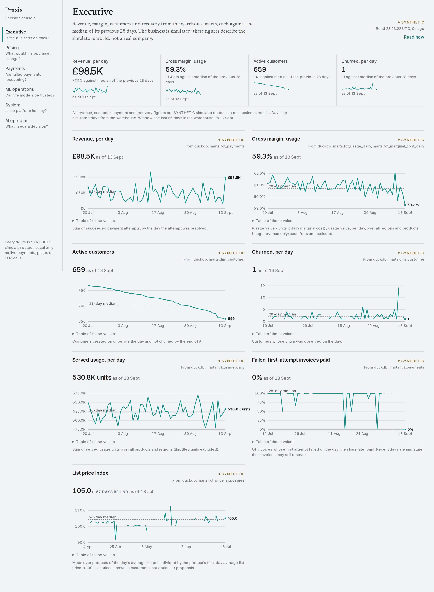

# Decision console

The console shows what Praxis is doing and lets a named person decide the few things that need a
person. It reads only real state: Postgres, the warehouse and the fleet metrics. Its only writes
are approving or rejecting a request and lifting a price freeze. Decision: ADR 0021.



More screenshots, including dark mode and phone width, are in
[evidence/phase-13/](evidence/phase-13/).

## Run it

```bash
make pg-up
make console-demo          # a throwaway demo database built through real code paths, seed 1
PRAXIS_DATABASE_URL=postgresql+psycopg://praxis@127.0.0.1:55432/praxis_console_demo \
PRAXIS_WAREHOUSE_PATH=data/pricing/seed1-c1000/warehouse.duckdb \
PRAXIS_CONSOLE_APPROVERS="alice=<token of 24+ characters>" \
make console-api           # http://127.0.0.1:8001/v1/console/*
make console-web           # http://127.0.0.1:3000
```

Without `PRAXIS_CONSOLE_APPROVERS` the console is read-only. A token can carry an expiry
(`name=token@YYYY-MM-DD`); outside `local` every token must expire within 90 days or the console
refuses to start. `scripts/console_token.py rotate` adds a new token and gives the old one an
overlap period, reading and writing the secret through pipes.

`make console-demo` rebuilds `praxis_console_demo` from: a staged alert that leads the
deterministic triage to request a price freeze, a 300-customer `run-local` world, 42 dunning
journeys on the synthetic gateway, eight shadow pricing cycles, and the seed-1 forecaster. The
demo force-promotes that forecaster as an audited override, and the MLOps view shows it as
forced.

## Views

| View | Question | Reads |
| --- | --- | --- |
| Executive | Is the business on track? | Warehouse marts, each figure against the median of its previous 28 days |
| Pricing | What would the optimiser change? | Decisions with candidates, p05 to p95, guardrails, constraints, lineage and the record checksum |
| Payments | Are failed payments recovering? | Dunning cases, decisions, retry jobs, invoices |
| ML operations | Can the models be trusted? | Registry versions, stage history, validation and monitoring reports |
| System | Is the platform healthy? | Fleet health, dead letters, ingest freshness, the cost estimate |
| AI operator | What needs a decision? | Incidents, the agent audit trail, requests and freezes |

## Trust states

| You see | It means |
| --- | --- |
| SYNTHETIC | Simulator output, not a real business result |
| EXTERNAL / CONFIG | External data with its batch provenance, or a repository config file |
| SHADOW | A pricing decision recorded in shadow mode, not validated for execution |
| NO DATA + reason | The input does not exist yet. Never shown as 0 |
| UNAVAILABLE + reason | The store did not answer, or a table is not built |
| STALE 3h 12m | A source or process past its limit. The old values stay visible, dimmed |
| Error + correlation id | A failed call. The id finds it in the API's structured logs |

## Deciding

Open **AI operator** and paste your approver token; the API answers with your name, and the
browser keeps the token for that tab only. A pending request shows its rationale, evidence and
investigation trace. **Approve** runs the existing path (`ApprovalDesk` to `FreezeStore` or
`ModelRegistry`); **Reject** needs a reason; a request that is no longer pending is refused.
There is no route that sets a price, runs a payment or bypasses the optimiser.

## Design

The console is meant to read like an instrument panel. The data and its trust state are the
only loud things on the screen.

- **Type.** Newsreader for view titles only, Inter for everything else with tabular figures,
  IBM Plex Mono for identifiers. Nothing smaller than 12 px.
- **Colour.** One accent (teal) and four semantic colours: ok, degraded, stale, synthetic. A
  state is a short word and a small dot; whole panels never turn amber. No gradients or shadows.
- **Layout.** A 4 px grid, a navigation rail and a 12-column content area; at phone width
  everything collapses to one column. Panels are separated by hairlines, not boxes.
- **Readouts instead of KPI cards.** A row of figures, each with a label, unit, comparison,
  optional sparkline and its source and age.
- **Charts.** Hand-built SVG, one y-axis, horizontal gridlines only, the latest value labelled
  at the line's end, uncertainty drawn as a band, missing days drawn as gaps. Every chart has a
  table equivalent.
- **Motion.** Only a 120 ms fade on refresh and a 160 ms disclosure, both off under
  `prefers-reduced-motion`.

Colour tokens are defined once in `frontend/src/app/globals.css` for light and dark themes.

## Tests

- `tests/console/` (pytest, real Postgres and DuckDB): every panel, missing and stale inputs,
  provenance, decision detail, safe errors and the full admin path.
- `frontend/src/test/` (Vitest): the trust states, decision detail, error state, approver path,
  and a hygiene check that app code imports no fixture and reaches the network only through
  `lib/api.ts`.
- `frontend/e2e/journey.spec.ts` (Playwright, `make e2e`): an alerting signal becomes an
  incident, an investigation and a pending request; a bad token is refused, an authorised
  approval creates the freeze, and a second approval is refused.

## Limits

- Fleet metrics are latest values only, so the console draws no history from them.
- The cost panel is an estimate from `configs/console/cost.toml`; no billing data is read.
