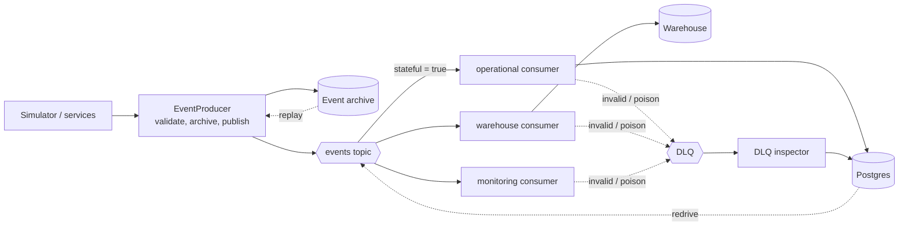

# Event backbone

Events move over Pub/Sub, which delivers at least once, in no guaranteed order. The backbone is
built on that assumption: every consumer is idempotent, out-of-order events wait until their
predecessor arrives, and a message that keeps failing ends up in a dead-letter queue where an
operator can redrive it after the fix. Design: ADR 0001, 0009 and 0025.



The producer rejects a whole batch if any event is invalid, and archives before it publishes.
The archive is append-only and checksum-verified on read, so any history can be replayed.

## Consumers

| Consumer | Guarantee |
| --- | --- |
| Operational (`praxis.streaming.consumers.operational`) | Exactly-once effect: the idempotency row and the state change commit in one transaction |
| Warehouse | Insert-if-absent on `event_id` through the landing table (see [data-platform.md](data-platform.md)) |
| Monitoring | Delivery telemetry and duplicate detection |
| DLQ inspector | Stores every dead letter once, with reason, attempts and trace ids |

Only events marked `stateful` reach Postgres. Each customer and invoice is an aggregate whose
state is refolded from its own accepted events in canonical order, so arrival order does not
matter.

## Control plane tables

| Table | Holds |
| --- | --- |
| `processed_events` | Idempotency store, one row per (consumer, event) |
| `entity_events` | Accepted lifecycle events per aggregate |
| `customers`, `subscriptions`, `invoices` | Projections; state moves are guarded by trigger |
| `payment_ledger` | Money collected, BIGINT minor units |
| `state_transitions` | Audit of applied transitions |
| `dead_letters` | Open and redriven dead letters |
| `allowed_state_moves` | The Python state machines' reachable moves, enforced in SQL |

Migrations are Alembic, in `src/praxis/control/migrations`.

## Failure handling

| Situation | What happens |
| --- | --- |
| Duplicate, redelivery or replay | Idempotency hit, no-op, ack |
| Out of order (payment before invoice) | Stored as pending, applied when the predecessor arrives |
| Malformed, unknown type or unsupported version | Dead-lettered on the first attempt |
| Database down | Transient error, NACK, backoff from 10 s to 300 s |
| Crash after commit, before ack | Redelivered, then a no-op |
| Poison message | Five attempts, then the DLQ |

**Crash isolation (ADR 0025).** Pub/Sub charges an attempt to every message in a lease that
ends without an ack, so batch processing once let one crashing message dead-letter its healthy
batch-mates. Every pull loop now goes through `FlowControl` / `process_pull`: slow start after a
restart, first deliveries and redeliveries processed as separate groups, and any message
redelivered twice processed on its own. A real poison message isolates itself.

## Commands

```bash
make pg-up pubsub-up            # local Postgres and the Pub/Sub emulator
make pubsub-verify              # producer and consumers over the emulator
make events-local               # 1K customers x 28 days with injected faults vs the oracle
make events-bench               # latency on the emulator
python -m praxis.streaming --database-url URL migrate
python -m praxis.streaming --database-url URL dlq             # list open dead letters
PUBSUB_EMULATOR_HOST=127.0.0.1:8085 python -m praxis.streaming --database-url URL dlq --redrive
python -m praxis.streaming replay --archive data/events/archive
```

`run-local` refuses a control plane that already holds processed events, because its oracle
only covers the world it generates.

## Scale

Consumers scale out as independent shard processes over one Postgres, with messages assigned by
`event_id` hash, so the idempotency and locking design runs under real contention. Postgres
takes one transaction per stateful event (about 5 % of events), so throughput comes from more
writers rather than bigger batches. Batch sinks wait up to a second to fill a batch. Measured
results are in [results.md](results.md#performance-and-scale) and ADR 0022.

## Known limits

- `processed_events` has no retention job yet.
- Cross-aggregate rules (an invoice only for an active customer) are dbt checks, not
  control-plane constraints, because aggregates can arrive in either order.
- A permanently invalid lifecycle event stays pending rather than dead-lettered: online,
  "never" and "not yet" look the same.
